# The v1 interface: report (Brief 5)

Version **0.9.0**. Branch `interface`. The design is `docs/interface.md` (rulings in §12, as built in §13 and §14). This report says what was built, how it was checked, and what is left.

## What exists

The editor, both faces, the screens around them and the Mac menus, in Everforest Soft Dark, in plain TypeScript and DOM:

- **The editor** (CodeMirror 6, one per writing session): light prose dressing from 0.17.1, ⌘B and ⌘I, find and replace (⌘F, ⌥⌘F), spellcheck (the Mac's own language settings), a readable centred column, undo that survives saves and reloads, silent saving, reloads from disk applied as the minimal edit.
- **The storytelling face:** the navigator (current novel, chapter selector, "add the next chapter"), the Codex tree (virtual folders, type icons, drag and keyboard reordering, set type, archive, new file and folder; clicking an entry opens it in the lore slot, clicking it again closes it) and the stats.
- **The storyForge face:** codex, series, novel and archive tabs. The series title is renamed on the series tab; the harness's chapter tab is merged into the novel tab.
- **The context panel** (the lore slot of the design): always there, blank when empty. Naming: the left panel is storytelling | library, the centre the workspace, the right the context (`docs/interface.md` §15).
- **Screens:** start, New Project, the reconciliation summary (only when something happened), Codex renaming (name, plan, result), settings (⌘,), notices (transient and sticky).
- **Menus:** storyForge, File (with Open Recent), Edit, View, Story, Window; items greyed out when they don't apply.
- **A browser preview** and 99 WebKit tests.

## How it was checked

| | |
|---|---|
| Typecheck (`npm run build`) | clean |
| `npm test` (Vitest, including the disk-safety suite) | **1,151 tests** passing (1,109 before this brief) |
| `cargo test --workspace` | **29 tests** passing |
| `npm run test:ui` (WebKit, against the real Rust file code) | **99 tests** in 8 files, all passing |
| The built universal app | launches, stays up, **0 network sockets** |

I cannot see the Tauri window. Everything visual was checked in Playwright's WebKit (the engine closest to macOS's own) and by Kenny at H2 (the storytelling face); the storyForge face, the screens, settings and the menus have **not yet been tried in the built app by a person** (see "Not done").

The release bundle contains no diagnostic page (`test/releaseBuild.test.ts` builds it and checks). CI is unchanged (install, typecheck, test, the Rust file-system tests): the WebKit tests are **not** in CI. A Linux runner would need WebKit's system packages and the Rust bridge built first, and GitHub Actions stays off for release work; they run on the Mac with `npm run test:ui`.

## Screenshots

From Playwright's WebKit against synthetic fixtures (`docs/interface-shots/`, regenerated by `npm run ui:shots`). The prose font shows a fallback serif off a Mac.

| | |
|---|---|
| 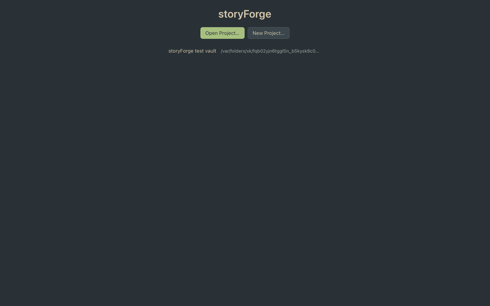 | 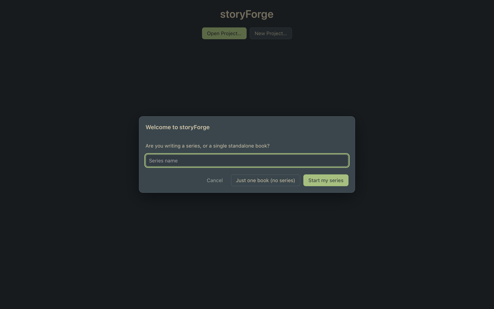 |
| 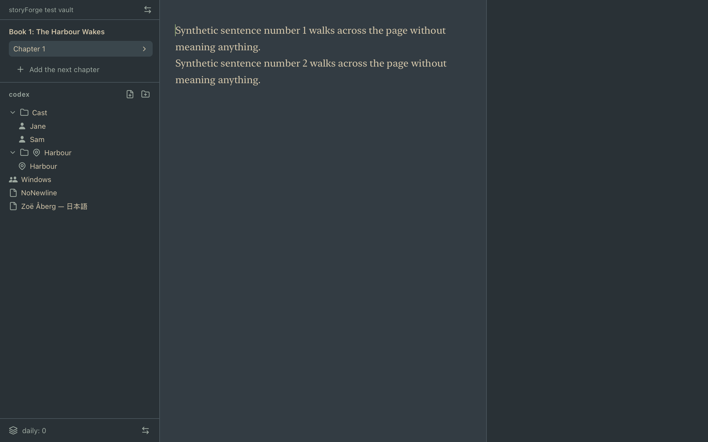 | 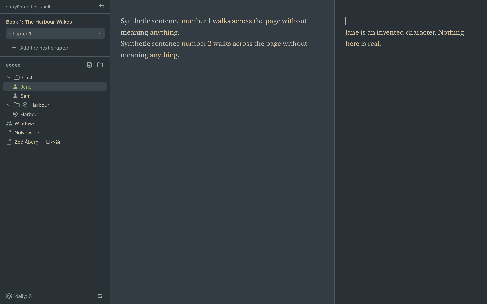 |
| 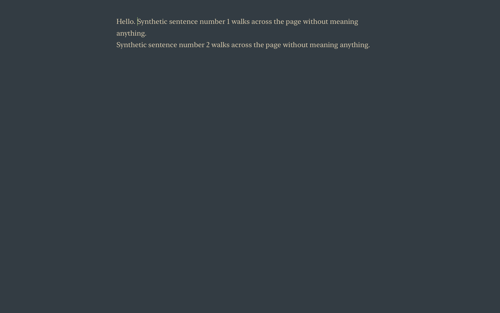 | 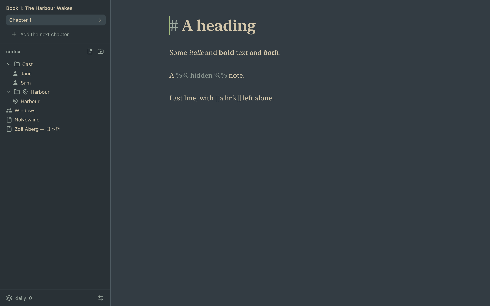 |
| 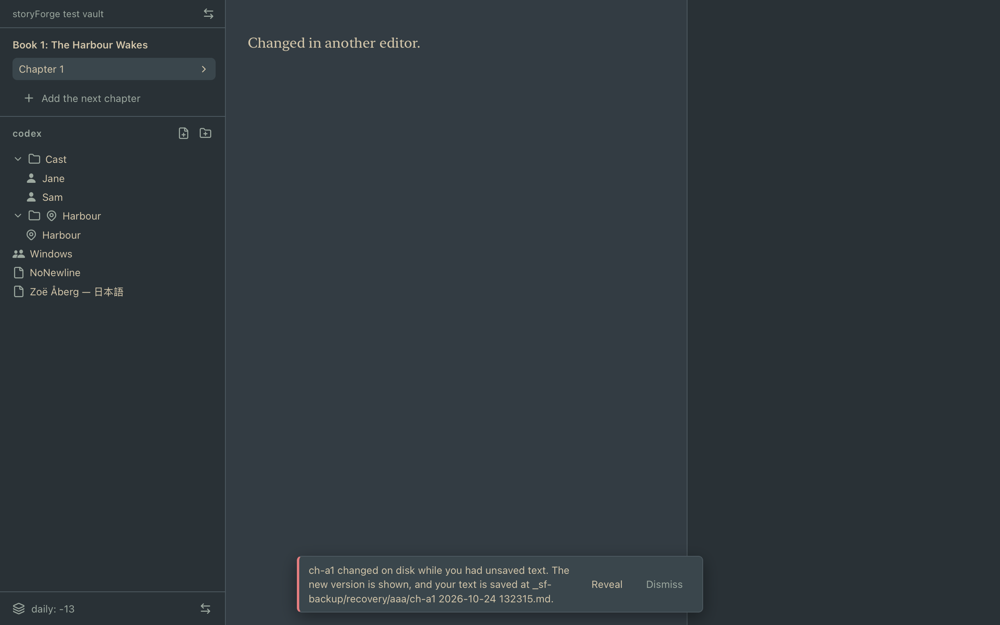 | 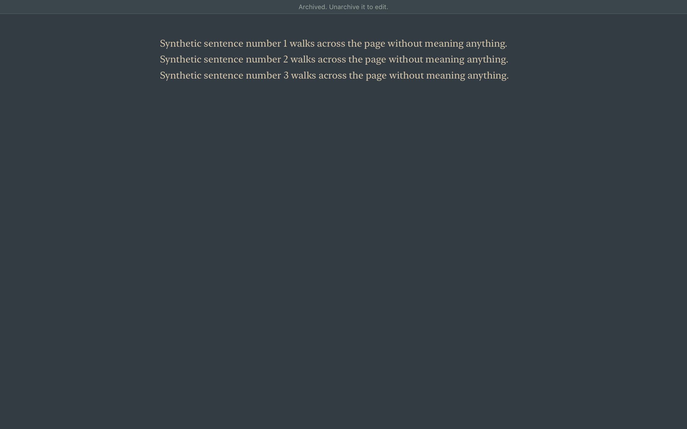 |
| 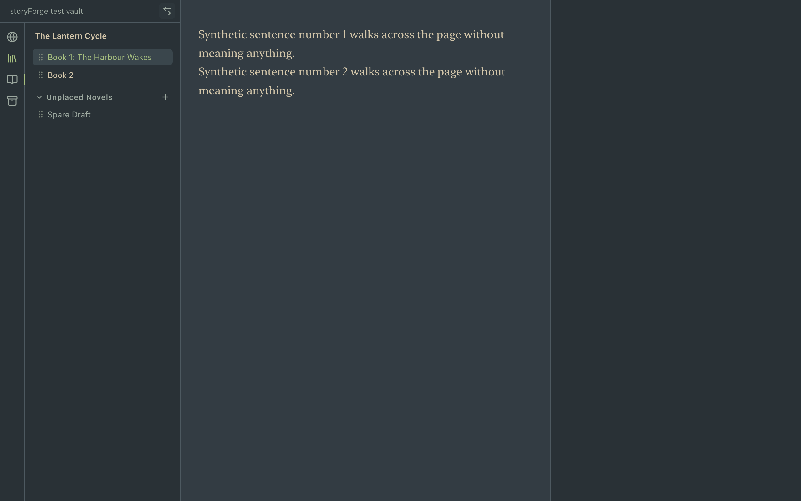 | 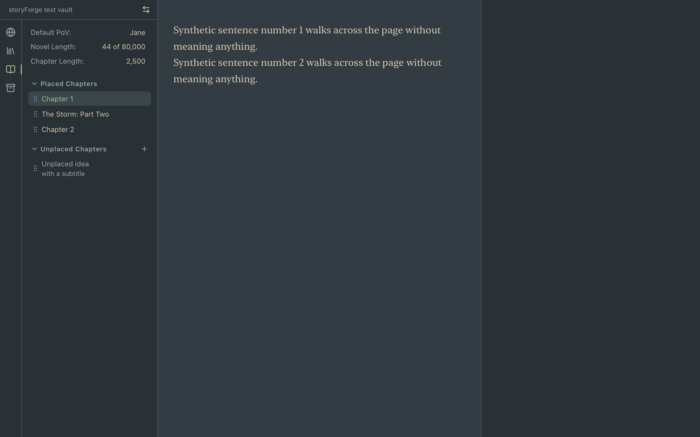 |
| 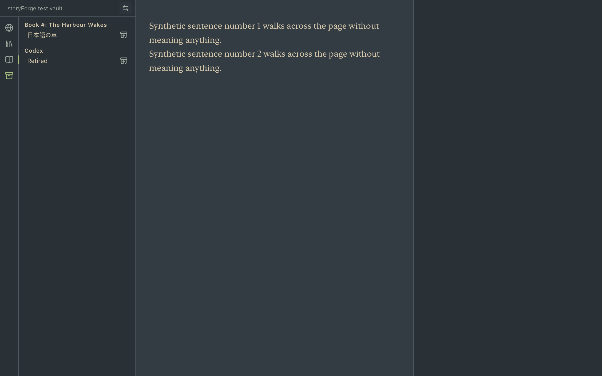 | 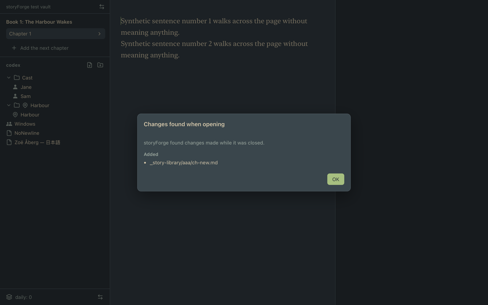 |
| 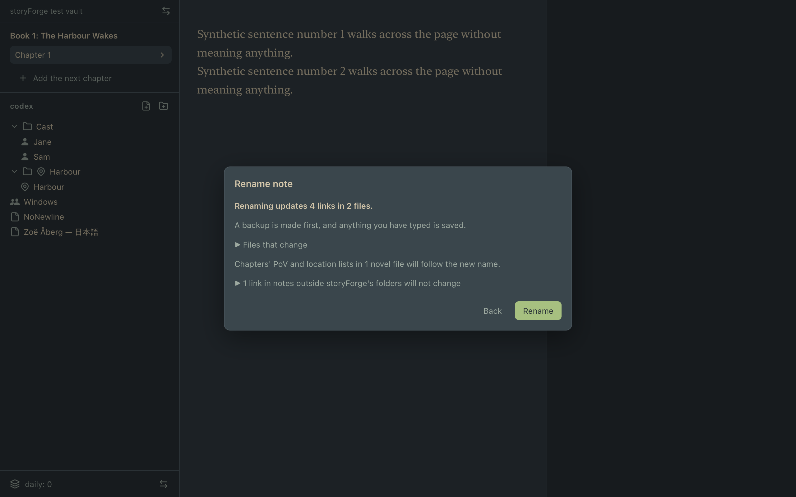 | 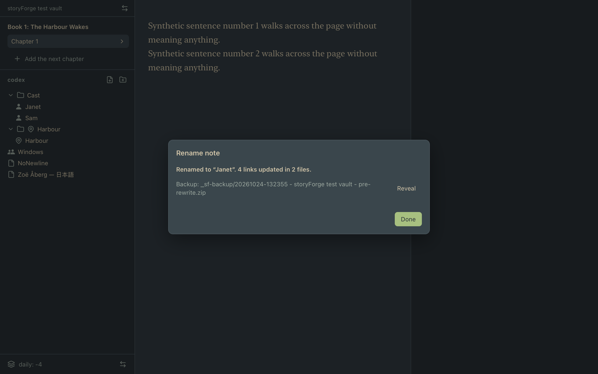 |
| 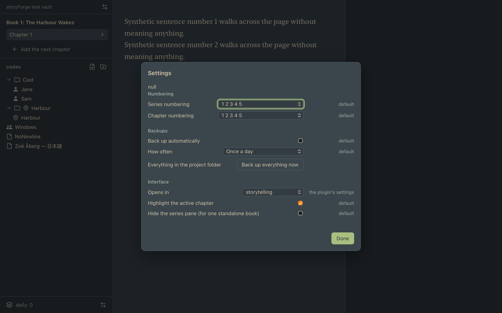 | 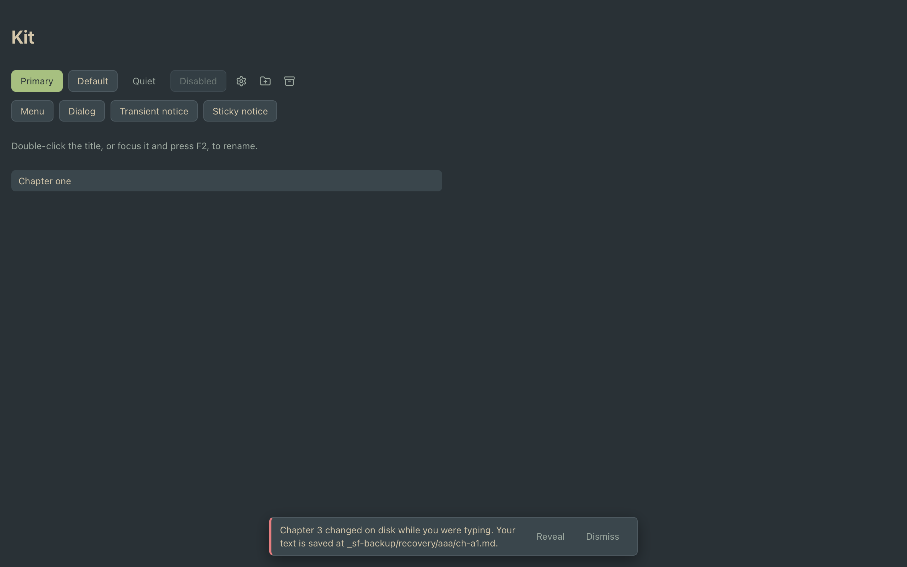 |

## New packages

| Package | Licence | Where |
|---|---|---|
| @codemirror/state, view, commands, search | MIT | the app |
| lucide | ISC (some icons MIT, from Feather) | the app, bundled locally, only the icons used; `Icon Licences.md` |
| @playwright/test | Apache-2.0 | **development only** |

Recorded in `Code Attributions.md`. The window's bundle is **728 KB** of JavaScript and 18 KB of CSS (the Codex type icons from the core's icon catalogue are most of what isn't CodeMirror). The universal `.app` is 7.4 MB and the `.dmg` 3.5 MB.

## New Rust commands

| Command | What it does | Writes? |
|---|---|---|
| `reveal_in_finder(path)` | Shows a file of the open project in Finder (`open -R`). The path is project-relative and checked like a read (a safe path, no link that leaves the project, and it must exist). | no |
| `set_menu_state(enabled)` | Sets the app's own menu items enabled or disabled (decision 26, ruling 5). | no, touches no file |

Each is in the window's allow-list (`test/tauriConfig.test.ts` enforces the list). There is still no file-system, shell, network or dialog permission. Changes to the core: `ProseSession.onSaveResult` (ruling 1) and `OpenedProject.renameNote`, both additive and tested; nothing else.

## The shortcuts as built

| | |
|---|---|
| storyForge | Settings… ⌘, · Quit ⌘Q |
| File | New Chapter ⌘N · New Project… ⇧⌘N · Open Project… ⌘O · Open Recent ▸ · Close Project |
| Edit | Undo ⌘Z · Redo ⇧⌘Z (app items) · Cut, Copy, Paste, Select All · Find… ⌘F · Find and Replace… ⌥⌘F |
| View | Flip Face ⌘\\ · Show or Hide Lore Slot ⌥⌘\\ · Developer ▸ Diagnostics (development builds only) |
| Story | Archive · Rename… · Back Up Now (none have a shortcut) |
| In the editor | ⌘B bold · ⌘I italic |
| In lists | F2 renames the focused row · ↑ ↓ on a drag handle reorder it · ↑ ↓ on a Codex row move it |

## Ported helpers

See `docs/interface.md` §14. In short: the dressing scanners are unchanged; the dressing view is simplified to one file per editor; inline rename uses the kit's menu and explains a refused name; `dragReorder` **no longer captures the pointer** (see below); the other helpers are used as they are.

## Hold points

- **H1** (the design): reviewed; the rulings are decision 26 in `docs/interface.md` §12.
- **H2** (the storytelling face, in the built app): Kenny found it right apart from one thing — the lore slot must be there, blank, from the start. Fixed in the next commit and recorded in §12.
- No hold was hit during the build: no core behaviour changed beyond the two approved additions, no new permission, no package beyond the approved ones, no cut feature came back.

## After Kenny's first look (24 October 2026)

- **Naming:** left panel *storytelling | library*, centre *workspace*, right *context* (`docs/interface.md` §15). The control is "Flip side"; the View menu says Flip Side and Show or Hide Context; the settings say "Opens in: storytelling / library".
- **Library ▸ codex opens an entry in the workspace**, not the context panel; only storytelling opens entries in the context panel. Flipping back to storytelling puts the selected chapter back in the workspace.
- **Padded numbering shows "01"** (two digits at least). This changes a kept module's behaviour (`formatNumber`), at Kenny's request, with its test.
- **A chapter dropped into the unplaced list stays where it was dropped.** The order is saved in `unplaced:` (an existing 0.17 key) and followed on reading; new core function `writeBookUnplacedOrder`, with a core test and a disk-safety operation.
- **Not yet done by Kenny:** the quit test (⌘Q and the red button, with unsaved text, then reopen).

## Things that went wrong, and what was learned

- **WebKit hung on the first drag between two lists.** The harness's `dragReorder` captured the pointer and re-captured it from a `lostpointercapture` handler after moving the row between lists; in WebKit that call hangs the page. It would have hung the app the first time a chapter was dragged between placed and unplaced. The WebKit tests found it; the fix (no capture; the window-level listeners already see the gesture) is in `src/view/dragReorder.ts`.
- **Two commits went in with a failing test** (commit 4's architecture test, commit 7's, both because I chained commands with `;` instead of stopping on a failure). The architecture test is why renaming goes through `OpenedProject.renameNote`. Both were fixed in the next commit and I now gate every commit on the whole run.
- **A race in the editor host:** two opens of the same file in the same moment (a click during start-up) shared one session, and the loser closed it. Now a second open waits for the first. A test covers it.
- **WebKit does not focus a button on click.** A dialog or menu opened by a button could not give focus back to it. The kit's buttons now focus themselves when pressed.
- **A flaky timing assertion** in the core's observer test (it guessed how long a timed save takes) now waits for the save.

## Surprises

- The Codex type icons come from the core's 170 KB icon catalogue (custom SVGs, kept for exactly this by decision 15). They are most of the bundle apart from CodeMirror.
- `ProseWriter.open` refuses archived files and read-only projects, so those are shown without a session (read-only editor, same dressing), with a quiet banner saying why.
- Renumbering after an archive: archiving "Chapter 1" makes the next `#`-titled chapter read "Chapter 1". That is the numbering working, but it surprised the first test.

## Not done

- **Kenny's check in the built app** (Brief 5 §5): write a few paragraphs with bold and italic; open a Codex note in the lore slot and close it; create, rename, place and archive chapters in the storyForge face; rename a Codex note that a chapter links to; change a numbering style and check `project.md` appears in `_backstage/storyforge/`; quit with unsaved text and reopen. **Pending**; the definition of done needs it done or waived before the merge.
- **Visual polish** Kenny said he would raise himself (H2). None concerns behaviour.
- **Known gap from Brief 4:** quitting from the Dock's menu can lose the last 2 seconds of typing (README). The interface does not change that.
- **Untested in the real window** (no way to see it from here): ⌘Z in the editor, in a rename field and in a settings field (the Undo and Redo items are app items for this reason), the menus' greyed-out states, the native folder picker's two titles, Reveal in Finder, the iCloud placeholder banner, reduced motion with the Mac's real setting.
- **Out of scope, as the brief says:** the overviews, word-count bars and history (v1.1); creating Codex types and filtering by type; other themes; fuller live preview; notarisation and auto-update.
