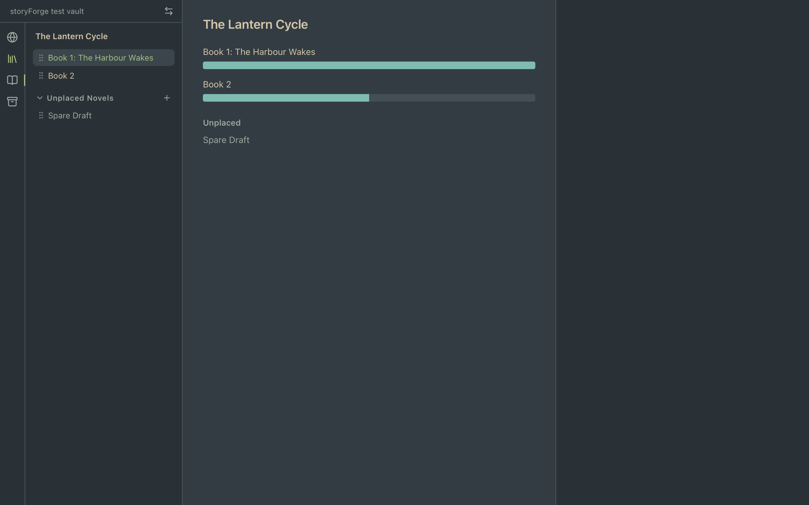
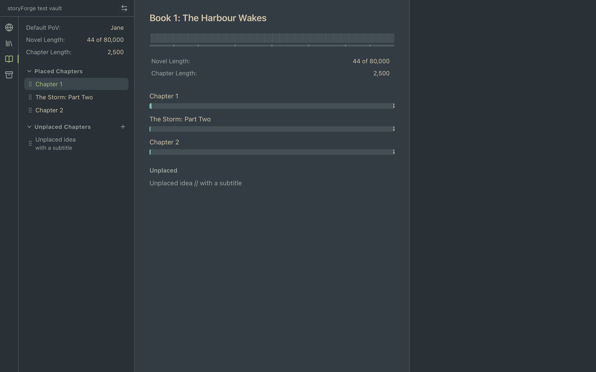
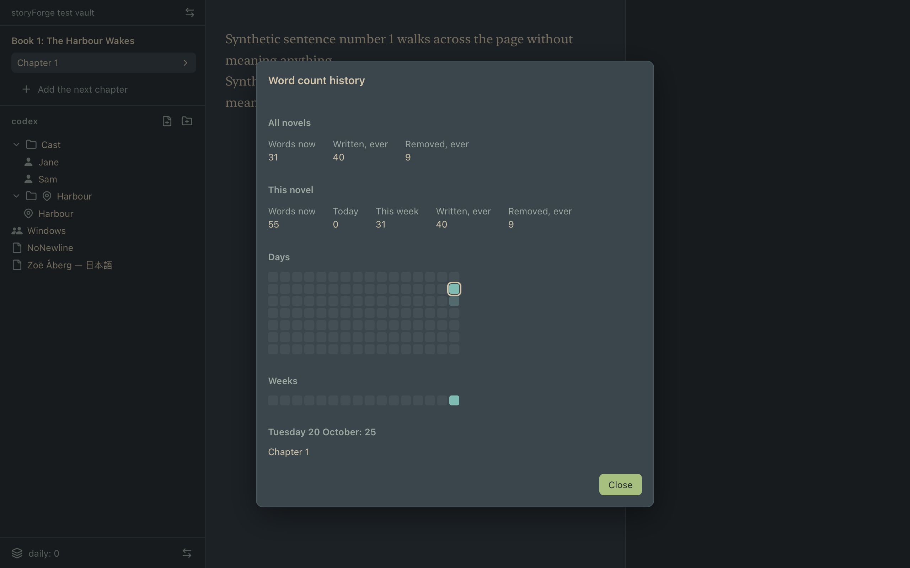

# The numbers: report (Brief 6)

Version **0.10.0** (1.0 has not been declared). Branch `numbers`. The design is `docs/numbers.md` (H1 rulings in §11, as built in §12).

## What exists

- **The series overview** (series tab, centre): each placed novel with a word-count bar scaled against the longest placed novel; an empty novel shows the 3 px sliver; unplaced novels beneath; clicking a novel selects it and shows the novel tab.
- **The novel overview** (novel tab, centre): the progress bar (segments for chapters with words, ghost chapter dividers, the structure strip), the planned lengths (the same field as the left panel's, committed on Return or blur), and one bar-tier card per placed chapter. Clicking a segment or a card opens the chapter. Hovering a card's bar shows its word count and, once read, the first paragraph of its plot note.
- **The history view** (the stats chart, as a dialog): all novels, this novel, the day and week heatmaps and a day's per-chapter breakdown.
- **Live refresh:** 250 ms trailing debounce, focus kept, the editor untouched.

## How it was checked

| | |
|---|---|
| Typecheck (`npm run build`) | clean |
| `npm test` | **1,171** passing (1,164 before the brief) |
| `cargo test --workspace` | all passing (nothing changed on the Rust side except the version) |
| `npm run test:ui` | **118** passing (102 before the brief) |
| `npm run app:build` | builds `storyForge_0.10.0_universal.dmg` |

Opening each overview and the history view is tested to leave the project folder byte-identical. I have not run the built app by hand; the checks are in WebKit against the real Rust bridge.

## Screenshots

| | |
|---|---|
|  |  |
|  | |

The fixture novels hold a few dozen words against a plan of 80,000, so the progress bar is nearly all ghost dividers and the chapter fills are slivers. Kenny's check on a real vault is what shows the bars at realistic scale.

## Differences from 0.17.1

- Overrun is data orange beyond a `bg_dim` notch at the plan, replacing the dotted pattern (decisions 8 and 28).
- Net-loss days are neutral greys in four steps, never red; the number is in the label (decision 28).
- Ghost dividers and the structure strip have no switches (decision 27).
- The overview is a layer over a still-mounted, inert editor rather than a replacement of it (decision 28).
- The planned-length field is one shared component, committing on blur or Return.

## Hold points

- **H1** (commit 1): `docs/numbers.md` reviewed; six rulings recorded as decision 28.
- No maths module needed changing, nothing writes to the project, and no cut feature was needed. `readChapterPlot` already existed, so no core change was needed for the tooltips.

## Surprises

- The screenshots showed two mistakes the tests had not: the history breakdown and the novel overview's title used raw titles ("Chapter #", "Book #:") where the left panel numbers them, and the dashed marker was half clipped at a bar's right edge. Both are fixed and the first is tested.
- The purposes test reads a purpose name as letters and hyphens, so the heat steps are `heat-a` to `heat-d`, not 1 to 4.
- Outside edits in the preview need an emitted `watch-batch` as well as the file change.
- The app opens on the chapter, so an overview shows only after the series or novel tab is selected; this follows the brief's rule but is worth Kenny's eye in the check.

## Not done

- Kenny's check in the built app (below).
- The history view's tooltip text for the plot note is not asserted in a test (the fixture's plot notes were not checked).

## Kenny's check

On a copy of the vault or a fixture copy:
1. Open the series tab and check the bars against what you know of each novel.
2. Open the novel tab; set the planned lengths and check the ghost dividers and the structure strip.
3. Write in a chapter until its bar passes its plan, and watch it turn orange beyond the notch.
4. Click the stats chart and look at the history view.
